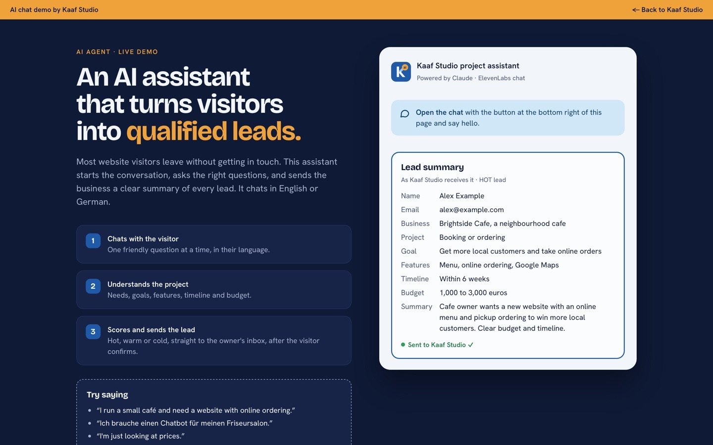

# AI Project Assistant: lead qualification agent

An AI agent for business websites that chats with visitors, understands their project, scores the lead, and sends the owner a clear summary. It's built with **Claude by Anthropic**.

**Live demo:** [kaafstudio.de/demos/ai-agent](https://kaafstudio.de/demos/ai-agent/) (also the chat bubble on [kaafstudio.de](https://kaafstudio.de)) · Built by [Kaaf Studio](https://kaafstudio.de)



## Two ways to run it

| | **ElevenLabs version (live on kaafstudio.de)** | **Self-hosted version (Cloudflare Worker)** |
|---|---|---|
| Folder | `elevenlabs/` | `worker/` and `demo/` |
| Where Claude runs | ElevenLabs Agents, with Claude Sonnet 5 as the model | Your own Cloudflare Worker, calling the Anthropic API |
| What you need | An ElevenLabs account | An Anthropic API key and a Cloudflare account |
| Chat window | ElevenLabs' ready-made widget (English and German picker, consent terms) | Custom chat page in `demo/` |
| Lead hand-off | A client tool, `submit_lead`, handled by `elevenlabs/chat.js` in the browser | A `submit_lead` tool, handled in the page after the Worker replies |

Both versions use the same idea: Claude asks questions, calls a `submit_lead` tool with a strict set of fields once the visitor confirms, and the lead is emailed to the owner.

## What it does

1. **Chats with the visitor.** It asks one friendly question at a time, in the visitor's language.
2. **Understands the project.** It covers the business, what they need, the goal, must-have features, timeline and budget.
3. **Scores the lead** as hot, warm or cold, and shows the visitor a summary to confirm.
4. **Sends the lead** to the owner's inbox, but only after the visitor presses *Send*.

Most website visitors leave without getting in touch. An assistant like this starts the conversation for you and hands you leads that are ready for a quote.

## How the self-hosted version works

```
Visitor ──▶ Chat page (HTML/CSS/JS) ──▶ Cloudflare Worker ──▶ Claude (Messages API)
                 │                          │
                 │                          ├─ system prompt + submit_lead tool live here
                 │                          ├─ API key stays secret on the server
                 │                          └─ limits: allowed sites, message size, rate limit
                 │
                 └─ Claude calls submit_lead ─▶ lead card ─▶ visitor confirms ─▶ email (Web3Forms)
```

- **Tool use:** Claude decides when it has enough information and calls a `submit_lead` tool with a strict JSON schema (name, email, business, project type, goal, features, timeline, budget, lead score, summary).
- **Human in the loop:** the page shows the summary as a card, and nothing is sent until the visitor confirms or asks to change something.
- **Secure by design:** the browser never sees the API key. The Worker only answers allowed origins, caps message length and conversation size, and rate-limits each visitor.
- **Model:** `claude-opus-5-5` at low effort for quick chat replies, with server-side refusal fallbacks turned on.

## Files

| Path | What it is |
|---|---|
| `elevenlabs/agent-instructions.md` | The live agent's instructions and the `submit_lead` tool definition |
| `elevenlabs/chat.js` | Receives the `submit_lead` call in the browser, shows the lead card and emails the lead |
| `elevenlabs/demo-page.html`, `elevenlabs/chat.css` | The live demo page |
| `worker/worker.js` | Self-hosted version: Cloudflare Worker with system prompt, tool, validation and the Claude API call |
| `demo/index.html`, `demo/agent.css`, `demo/agent.js` | Self-hosted version: custom chat page |
| `docs/` | Screenshots for this README |

## Run the ElevenLabs version

1. In ElevenLabs, create a **text-only** agent, choose Claude Sonnet 5, and paste in the instructions from `elevenlabs/agent-instructions.md`.
2. Add the `submit_lead` **client tool** described there.
3. In the agent's **Security** tab, add your website to the allowlist and set a daily conversation limit.
4. Put the widget on your page with `<elevenlabs-convai agent-id="YOUR_AGENT_ID">` plus ElevenLabs' embed script, and load `elevenlabs/chat.js` after it. Set `WEB3FORMS_KEY` in `chat.js` to your own [Web3Forms](https://web3forms.com) key.

## Run the self-hosted version

1. **Get an API key** at [console.anthropic.com](https://console.anthropic.com) and set a monthly spend limit.
2. **Create the Worker.** In the Cloudflare dashboard, go to **Workers & Pages → Create → Worker**, paste in `worker/worker.js`, then deploy.
3. **Add the key.** In the Worker's **Settings → Variables and secrets**, add `ANTHROPIC_API_KEY` as a **Secret**. Optionally, add `ALLOWED_ORIGINS` (comma-separated) for your own domain.
4. **Connect the page.** In `demo/agent.js`, set `AGENT_URL` to your Worker's address, and `WEB3FORMS_KEY` to your own [Web3Forms](https://web3forms.com) key.
5. **Publish** the `demo/` folder on any static host.

To try the chat flow without a key, open the page with `?mock` at the end of the address.

## Customise it

Edit `SYSTEM_PROMPT` and the `submit_lead` schema in `worker/worker.js`. The same pattern works for a restaurant (menu questions and orders), a salon (bookings) or a shop (product questions).

---

Want an assistant like this for your business? **[kaafstudio.de](https://kaafstudio.de)**, with a free quote and a free sample.
